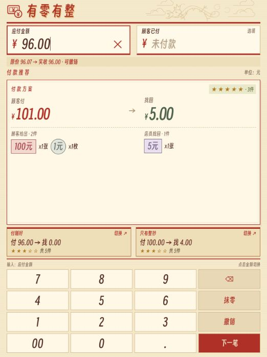

# 有零有整

人民币智能凑整找零计算器，让每一笔现金收付更简单。

输入应付金额和顾客已付金额，自动计算找零组合，并在更方便时提示：**“请问您有 1 元吗？再补 1 元，就能直接找您 20 元。”**

**[打开计算器](https://arrow36.github.io/smart-cash-change/)**

[](https://raw.githubusercontent.com/Arrow36/smart-cash-change/main/docs/preview.png)

点击截图查看原图。

## 为什么需要它？

应付 **31 元**，顾客付了 **50 元**：

| 方案 | 顾客再补 | 店员找回 | 本次额外交接的现金件数 |
| --- | --- | --- | --- |
| 普通找零 | 无 | 10 元 × 1、5 元 × 1、1 元 × 4 | 6 件 |
| 智能补零 | 1 元 × 1 | 20 元 × 1 | 2 件 |

有零有整同时计算顾客补付和店员找零的现金件数，只有总件数确实减少时才推荐补零。

## 功能

- **智能补零**：比较普通找零与补零方案，最多展示 3 个推荐方案。
- **付款推荐**：未填写顾客已付金额时，推荐付款与找零组合。
- **面额展示**：显示每种纸币、硬币的数量。
- **灵活设置**：调整补付范围、1 元纸币或硬币偏好，以及分币支持。
- **快捷抹零**：短按抹到角，长按抹到整元，并显示调整记录。
- **操作撤销**：恢复抹零、金额输入、清空及误触“下一笔”前的状态。
- **移动端布局**：内置数字键盘，适合手机触控操作。
- **本地运行**：HTML、CSS、JavaScript 单文件，无需服务器、数据库或登录。

## 快速开始

直接访问 [在线版本](https://arrow36.github.io/smart-cash-change/)，或下载仓库中的 `index.html`，用浏览器打开。

字体、图标和程序均已内嵌，本地文件支持离线运行。

## 使用方法

1. 输入应付金额。
2. 顾客尚未付款时，可先查看付款推荐。
3. 输入顾客已付金额，查看普通找零和补零建议。
4. 顾客有零钱时，点击“有零钱 · 采用”；没有零钱时，按普通方案找零。
5. 完成后点击“下一笔”。误触可点击“撤销”恢复。

点击金额框可切换输入对象。

- **退格**：短按删除一位，长按约 650 毫秒清空当前金额框。
- **抹零**：短按去掉分位，长按去掉角、分位；只调整应付金额。
- **撤销**：最多保留 40 步操作记录，刷新页面后清除。

## 推荐原理

所有金额均转换为整数“分”计算，避免小数运算误差。

```text
新找零 = 顾客已付 + 顾客补付 - 应付金额
交接件数 = 顾客补付的现金件数 + 店员找回的现金件数
```

仅保留交接件数严格少于普通找零的方案，再依次比较总现金件数、补付金额、店员找零件数。

默认补付搜索范围为 **0.10～5.00 元**，可在设置中调整。星级表示当前方案的相对便利程度，相同现金件数获得相同星级。

## 示例

| 应付 | 已付 | 结果说明 |
| --- | --- | --- |
| 31.00 元 | 50.00 元 | 普通找零 19 元；补 1 元后找 20 元 |
| 95.00 元 | 100.00 元 | 直接找 5 元，无需额外补付 |
| 100.00 元 | 50.00 元 | 提示还差 50 元 |
| 31.56 元 | — | 短按抹零至 31.50 元，长按至 31.00 元 |

## 部署与当前范围

本仓库通过 GitHub Pages 发布 `main` 分支根目录中的 `index.html`。

- 在线版本尚未添加 Service Worker，不保证断网后重新加载可用；需要稳定离线使用时，请保存本地 HTML 文件。
- 默认所需面额充足，暂不支持收银箱库存管理。
- 顾客是否持有推荐的零钱需现场确认。
- 撤销记录仅保存在当前页面会话中。
- 已检查小屏布局，实体手机体验仍欢迎反馈。

## 反馈

欢迎通过 [Issues](https://github.com/Arrow36/smart-cash-change/issues) 提交问题、建议或特殊金额案例。计算问题请附上应付金额、已付金额及相关设置。
